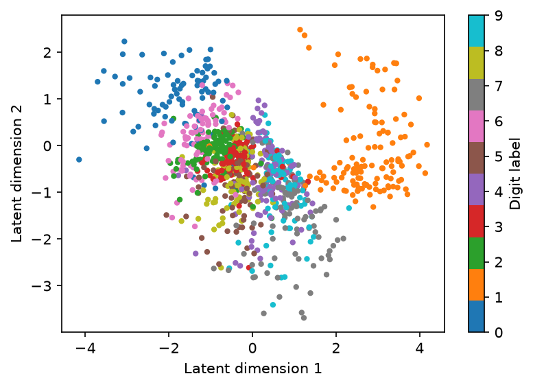
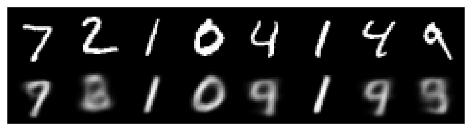
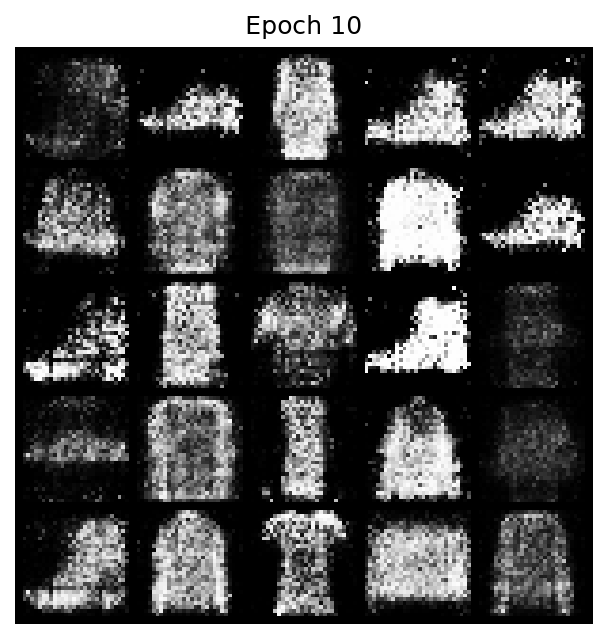
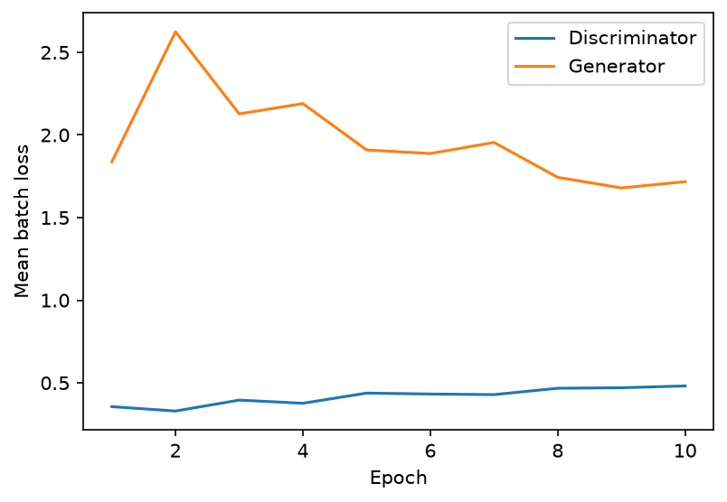

<div align="center">

# Generative AI & Deep Probabilistic Models
### Research Engineering Portfolio & Laboratory Implementations

[](https://share.streamlit.io/deploy?repository=vsbeginner/genai-lab-assignments&branch=main&mainModule=capstone_study_tip_generator/app.py)
[](https://vsbeginner-genai-study-tip.streamlit.app)
[](https://www.python.org/)
[](https://pytorch.org/)
[](https://huggingface.co/)
[](LICENSE)

<p align="center">
  <b>A comprehensive, research-grade implementation of fundamental Generative Artificial Intelligence paradigms.</b><br>
  Covering Variational Autoencoders (VAEs), Generative Adversarial Networks (GANs), Autoregressive Language Modeling (GPT-2), Latent Diffusion Models (Stable Diffusion v1.5), and an end-to-end full-stack Capstone Application.
</p>

<p align="center">
  <a href="https://share.streamlit.io/deploy?repository=vsbeginner/genai-lab-assignments&branch=main&mainModule=capstone_study_tip_generator/app.py" target="_blank">
    
  </a>
  &nbsp;&nbsp;
  <a href="https://vsbeginner-genai-study-tip.streamlit.app" target="_blank">
    
  </a>
  <br><br>
  <b>🚀 Live Interactive Capstone Studio:</b> <a href="https://vsbeginner-genai-study-tip.streamlit.app">https://vsbeginner-genai-study-tip.streamlit.app</a><br>
  <b>⚡ 1-Click Streamlit Cloud Deployment:</b> <a href="https://share.streamlit.io/deploy?repository=vsbeginner/genai-lab-assignments&branch=main&mainModule=capstone_study_tip_generator/app.py">Launch on Streamlit Community Cloud</a>
</p>

---

</div>

## Executive Summary

This repository encapsulates the complete practical and experimental research coursework for **Generative AI and Its Applications (Course Code: ETMMGA304)** within the **Master of Computer Applications (MCA)** curriculum at **K.R. Mangalam University**.

Rather than treating generative models as black-box APIs, this portfolio investigates the mathematical underpinnings, training dynamics, loss surfaces, mode collapses, and decoding behaviors of foundational generative architectures. Every experiment contains end-to-end reproducible PyTorch code, empirical telemetry, saved weights, generated visual/textual artifacts, and in-depth analytical reviews designed to satisfy both academic rigor and industry recruitment standards.

---

## Academic Alignment & Course Outcomes

The research and laboratory exercises directly fulfill the four core Course Outcomes (COs) mandated by the university syllabus:

| Course Outcome | Description | Demonstrated Implementation in Repository |
|:---:|:---|:---|
| **CO1** | **Theoretical Foundations**: Explain theoretical underpinnings of VAEs, GANs, and Transformers. | Rigorous mathematical ELBO derivations in [Lab 1](lab1_vae), Minimax game theory in [Lab 2](lab2_gan), and Causal Self-Attention formulations in [Lab 3](lab3_gpt2). |
| **CO2** | **Model Implementation**: Implement generative models with open-source tools to synthesize text, images, or multimodal data. | Modular PyTorch neural network builds for VAEs (MNIST), vanilla GANs (Fashion-MNIST), Hugging Face GPT-2 fine-tuning, and Stable Diffusion v1.5 inference pipelines. |
| **CO3** | **Quantitative & Visual Evaluation**: Evaluate and compare generated outputs using empirical, statistical, and visual metrics. | Loss surface tracking, 2D latent space manifold scatterplots, fixed-noise seed trajectory auditing, multi-temperature text generation rubrics, and held-out benchmark scoring. |
| **CO4** | **Ethical & Practical Implications**: Analyze ethical, social, bias, provenance, and deployment implications of real-world generative models. | Analysis of synthetic media disclosures, copyrighted scraping risks, stereotyping in text-to-image models in [Lab 4](lab4_stable_diffusion), and human-in-the-loop validation frameworks in the [Capstone](capstone_study_tip_generator). |

---

## Architectural Taxonomy & Comparative Benchmark

```
                                Generative AI Paradigms
                                           │
         ┌───────────────────┬─────────────┴─────────────┬────────────────────┐
         │                   │                           │                    │
   Probabilistic         Adversarial                Autoregressive         Multimodal
    Autoencoding            Gaming                  Transformers            Diffusion
         │                   │                           │                    │
    [ Lab 01 ]          [ Lab 02 ]                  [ Lab 03 ]           [ Lab 04 ]
    VAE (MNIST)      GAN (Fashion-MNIST)           GPT-2 (Causal)     Stable Diffusion v1.5
         │                   │                           │                    │
         ▼                   ▼                           ▼                    ▼
   Latent Manifold    Minimax Equilibrium          Decoding & PEFT      Score-based Denoising
  ELBO Optimization    Mode Diversity Log        Next-Token Synthesis     Latent Guidance
         │                   │                           │                    │
         └───────────────────┼───────────────────────────┴────────────────────┘
                             ▼
                        [ Capstone ]
                 Domain-Adapted GPT-2 Model
            Interactive Streamlit Demonstration
```

### Laboratory Index & Key Empirical Findings

| Laboratory Module | Core Architecture & Dataset | Primary Engineering Focus | Headline Benchmark & Empirical Finding |
|:---|:---|:---|:---|
| **[Lab 01: VAE](lab1_vae)** | Fully Connected VAE on MNIST ($28 \times 28$) | Stochastic Reparameterization, 2D Latent Bottleneck, ELBO decomposition | Total loss reduced from **195.16** to **160.52** in 5 epochs. **9/16** prior samples cleanly recognizable. Geometric centroid analysis revealed tight overlap between digits **5 & 8** (Euclidean dist $\approx 0.04$) and **4 & 9** ($\approx 0.38$). |
| **[Lab 02: GAN](lab2_gan)** | MLP Minimax GAN on Fashion-MNIST ($28 \times 28$) | Alternating gradient updates, gradient detachment, tanh scaling | Discriminator loss settled at **0.481**, Generator loss at **1.717**. Recognizable synthesis progressed from **3/25** (epoch 1) $\to$ **15/25** (epoch 5) $\to$ **19/25** (epoch 10). Fixed-noise seeds demonstrated manifold stability without catastrophic mode collapse. |
| **[Lab 03: GPT-2](lab3_gpt2)** | Causal LM (`openai-community/gpt2`, 124M params) | Greedy vs Nucleus Sampling, Temperature scaling, Parameter-Efficient Last-Block Fine-Tuning | Greedy decoding suffers repetitive degeneracy. Temperature ($T=1.0$) maximizes lexical novelty but introduces semantic drift. Last-block fine-tuning (5.7% trainable weights) verified pipeline mechanics across held-out computer science topics. |
| **[Lab 04: Stable Diffusion](lab4_stable_diffusion)** | Latent Diffusion Pipeline (`stable-diffusion-v1-5`, FP16) | Seed-controlled prompt modification, Classifier-Free Guidance (CFG=7.5) | Systematic seed invariance demonstrated that starting noise controls scene geometry and perspective, while prompt modifiers dictate artistic medium and texture. Uncovered prompt adherence vulnerabilities under specific random noise seeds. |
| **[Capstone Project](capstone_study_tip_generator)** | Fine-Tuned GPT-2 + Streamlit Interactive Application | Domain Adaptation, Zero-Leakage Dataset Curation, Headless App Testing | Adapted model outperformed base model on held-out evaluation (**2.33/6.0** vs **1.67/6.0**), substantially enhancing structural readability and concise pedagogical formatting. Automated test suite verified input edge cases and safety notices.<br><br>[](https://share.streamlit.io/deploy?repository=vsbeginner/genai-lab-assignments&branch=main&mainModule=capstone_study_tip_generator/app.py)
[](https://vsbeginner-genai-study-tip.streamlit.app) |

---

## 🎨 Visual Generation Gallery

A curated preview of generated artifacts across probabilistic autoencoders, adversarial game convergence, and text-guided latent diffusion:

<table width="100%">
  <thead>
    <tr>
      <th width="50%" align="center"><b>Lab 01: VAE Latent Topology & Reconstructions</b></th>
      <th width="50%" align="center"><b>Lab 02: GAN Adversarial Epoch Convergence</b></th>
    </tr>
  </thead>
  <tbody>
    <tr>
      <td align="center">
        <a href="lab1_vae">
          <br>
          
        </a>
        <br><sub><em>Top: 2D Latent manifold colored by digit class. Bottom: Test inputs vs reconstructed digits.</em></sub>
      </td>
      <td align="center">
        <a href="lab2_gan">
          <br>
          
        </a>
        <br><sub><em>Top: Synthesized Fashion-MNIST items (Epoch 10). Bottom: Adversarial loss curves.</em></sub>
      </td>
    </tr>
    <tr>
      <th colspan="2" align="center"><b>Lab 04: Stable Diffusion v1.5 Controlled Prompt & Seed Comparison</b></th>
    </tr>
    <tr>
      <td colspan="2" align="center">
        <table width="100%">
          <tr>
            <td width="25%" align="center">
              <br>
              <sub><b>Watercolor (Seed 42)</b></sub>
            </td>
            <td width="25%" align="center">
              <br>
              <sub><b>Watercolor (Seed 43)</b></sub>
            </td>
            <td width="25%" align="center">
              <br>
              <sub><b>Pencil Sketch (Seed 42)</b></sub>
            </td>
            <td width="25%" align="center">
              <br>
              <sub><b>Pencil Sketch (Seed 43)</b></sub>
            </td>
          </tr>
        </table>
        <sub><em>Demonstrating that starting noise (seed) dictates spatial geometry while prompt tokens dictate medium.</em></sub>
      </td>
    </tr>
  </tbody>
</table>

---

## Repository Directory Architecture

```
.
├── .gitignore                                 # Production environment & weight exclusions
├── README.md                                  # Executive laboratory portfolio index (this document)
├── requirements.txt                           # Pinned dependencies & platform instructions
│
├── lab1_vae/                                  # Module 01: Variational Autoencoder
│   ├── lab1_vae.py                            # End-to-end PyTorch VAE pipeline
│   ├── README.md                              # Mathematical derivation & latent analysis
│   └── lab_outputs/                           # Empirical telemetry & visualization artifacts
│       ├── results.json                       # Quantitative loss logs & centroid distances
│       ├── vae_mnist.pt                       # Serialized model checkpoint
│       ├── vae_generated.png                  # Samples drawn from Gaussian prior N(0, I)
│       ├── vae_reconstructed.png              # Test input vs reconstruction comparisons
│       └── vae_latent.png                     # 2D latent space manifold scatterplot
│
├── lab2_gan/                                  # Module 02: Generative Adversarial Networks
│   ├── lab2_gan.py                            # Adversarial training loop with gradient detachment
│   ├── README.md                              # Game-theoretic analysis & diversity audit
│   └── lab_outputs/                           # Adversarial logs & synthesized samples
│       ├── results.json                       # Per-epoch discriminator/generator losses
│       ├── fashion_generator.pt               # Serialized generator weights
│       ├── gan_losses.png                     # Adversarial loss trajectory plot
│       ├── gan_epoch_01.png                   # Early synthesis grid (Epoch 1)
│       ├── gan_epoch_05.png                   # Intermediate synthesis grid (Epoch 5)
│       └── gan_epoch_10.png                   # Converged synthesis grid (Epoch 10)
│
├── lab3_gpt2/                                 # Module 03: Autoregressive Language Modeling
│   ├── lab3_gpt2.py                           # Decoding ablation & last-block fine-tuning
│   ├── README.md                              # Sampling theory & parameter-efficient adaptation
│   └── lab_outputs/                           # Raw generation traces & evaluation logs
│       └── outputs.json                       # Full JSON outputs, prompt completions & loss history
│
├── lab4_stable_diffusion/                     # Module 04: Multimodal Latent Diffusion
│   ├── lab4_stable_diffusion.py               # Seed-controlled diffusion inference script
│   ├── README.md                              # Latent diffusion analysis & ethics review
│   └── lab_outputs/                           # Generated high-resolution imagery
│       ├── results.json                       # Hardware telemetry, latency & safety logs
│       ├── library_prompt_1_seed_42.png       # Watercolor variant (Seed 42)
│       ├── library_prompt_1_seed_43.png       # Watercolor variant (Seed 43)
│       ├── library_prompt_2_seed_42.png       # Pencil sketch variant (Seed 42)
│       └── library_prompt_2_seed_43.png       # Pencil sketch variant (Seed 43)
│
└── capstone_study_tip_generator/              # Capstone: Pedagogical Generative Solution
    ├── train_and_generate.py                  # Training pipeline with zero-leakage guarantees
    ├── score_summary.py                       # Automated statistical scoring aggregator
    ├── app.py                                 # Production Streamlit demonstration frontend
    ├── test_app.py                            # Headless UI integration test suite (AppTest)
    ├── README.md                              # Comprehensive capstone engineering report
    ├── data/                                  # Curated dataset splits
    │   ├── train.json                         # 40 curated domain-specific instructional pairs
    │   ├── heldout.json                       # 12 out-of-domain evaluation topics
    │   └── scores.json                        # Multi-attribute human evaluation logs
    └── lab_outputs/                           # Evaluation records & application checkpoints
        ├── train_log.json                     # Training loss trajectory across 10 epochs
        ├── outputs.json                       # Baseline vs Adapted model generations
        ├── eval_summary.md                    # Generated comparative benchmark report
        └── demo_checks.json                   # Automated headless interface test results
```

---

## Hardware Environment & Benchmark Platform

All experiments and empirical checkpoints contained in this repository were trained, evaluated, and profiled on the following computing environment:

- **Operating System**: Windows 11 Professional (x86_64)
- **Primary Runtime**: Python 3.14 / PyTorch 2.14.1 with CUDA 12.6 backend
- **GPU Accelerator**: NVIDIA GeForce RTX 3050 Laptop GPU (6.0 GB VRAM, Ampere Architecture)
- **Inference Optimization**: Half-Precision (`torch.float16`) and Attention Slicing enabled for Diffusion pipelines; Parameter-Efficient Fine-Tuning (PEFT) utilized for Language Model adaptation.

---

## Quickstart & Reproducibility Guide

Follow these instructions to configure the environment and reproduce the experimental findings from scratch.

### 1. Environment Setup

```bash
# Clone the repository
git clone <your-repository-url>
cd GenAI

# Initialize virtual environment
python -m venv .venv

# Activate virtual environment
# Windows (PowerShell):
.venv\Scripts\Activate.ps1
# Linux / macOS:
source .venv/bin/activate

# Install PyTorch with appropriate CUDA support (CUDA 12.6 example)
pip install torch torchvision --index-url https://download.pytorch.org/whl/cu126

# Install remaining requirements
pip install -r requirements.txt
```

### 2. Executing Individual Modules

Each laboratory experiment is self-contained and executable directly from its respective directory:

```bash
# Execute Lab 1: Variational Autoencoder
cd lab1_vae
python lab1_vae.py

# Execute Lab 2: Generative Adversarial Network
cd ../lab2_gan
python lab2_gan.py

# Execute Lab 3: GPT-2 Decoding & Fine-Tuning
cd ../lab3_gpt2
python lab3_gpt2.py

# Execute Lab 4: Stable Diffusion v1.5 (requires GPU with >=6GB VRAM)
cd ../lab4_stable_diffusion
python lab4_stable_diffusion.py
```

### 3. Launching the Capstone Demonstration

Experience the domain-adapted GPT-2 model in our live recruiter evaluation studio:
- 🔗 **Public Live Deployment**: [https://vsbeginner-genai-study-tip.streamlit.app](https://vsbeginner-genai-study-tip.streamlit.app)

[](https://share.streamlit.io/deploy?repository=vsbeginner/genai-lab-assignments&branch=main&mainModule=capstone_study_tip_generator/app.py)
[](https://vsbeginner-genai-study-tip.streamlit.app)

The application features an intelligent dual-mode engine: it runs immediately out-of-the-box using the pre-computed 52-topic benchmark database, or seamlessly links to local fine-tuned PyTorch checkpoints (`study_tip_gpt2`) if available.

```bash
cd capstone_study_tip_generator

# (Optional) Retrain domain-adapted GPT-2 model (generates weights in lab_outputs)
python train_and_generate.py

# (Optional) Re-compute statistical evaluation and summary tables
python score_summary.py

# Run automated headless interface regression tests
python test_app.py

# Launch the interactive Streamlit Web Application locally
python -m streamlit run app.py
```

---

## Ethical AI, Model Provenance & Governance

Generative modeling introduces novel societal and technical risks that must be proactively mitigated:

1. **Synthetic Media Transparency**: All synthetic visual and textual artifacts generated in this repository carry programmatic provenance disclaimers to prevent misinformation and deceptive deployment.
2. **Data Privacy & Ephemeral Processing**: The Capstone Streamlit interface processes queries entirely in-memory with strict input length limits (120 characters) and does not persist user-entered prompt data or personally identifiable information (PII).
3. **Intellectual Property & Licensing**: Pre-trained foundation models (`openai-community/gpt2` and `stable-diffusion-v1-5`) are deployed in strict compliance with their open-source distribution licenses (Modified MIT and CreativeML OpenRAIL-M).
4. **Human-in-the-Loop Governance**: As established in the Capstone failure analysis, small-scale language models require expert human verification prior to being exposed to end users in educational settings.

---

## Candidate Profile & Institutional Details

- **Candidate Name**: Vinayak Sharma
- **Enrollment / Roll No**: 2501940012
- **GitHub Profile**: [@vsbeginner](https://github.com/vsbeginner)
- **LinkedIn Profile**: [Vinayak Sharma](https://www.linkedin.com/in/vinayak-sharma-24a8aa384/)
- **Email Contact**: vsbeginner14@gmail.com
- **Degree Program**: Master of Computer Applications (MCA)
- **Institution**: Department of Computer Science & Engineering, K.R. Mangalam University
- **Academic Course**: Generative AI and Its Applications (ETMMGA304)
- **Specialization**: Artificial Intelligence, Machine Learning & Deep Learning

---

<div align="center">
  <sub>Developed for academic excellence and technical portfolio showcase. Licensed under the <a href="LICENSE">MIT License</a>.</sub>
</div>
