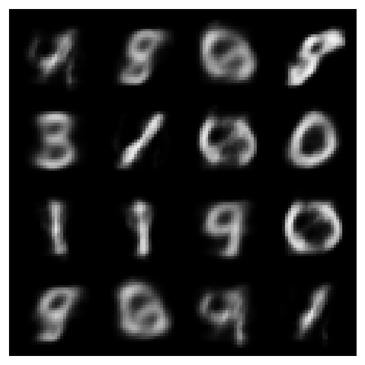
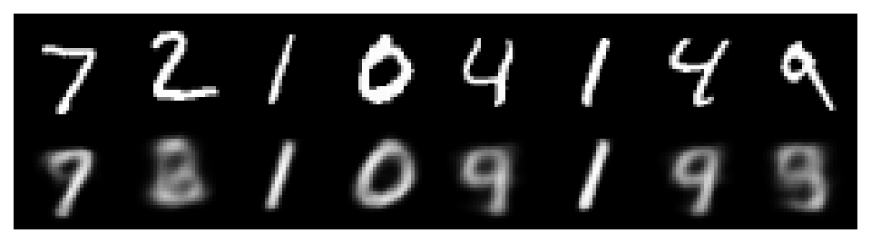
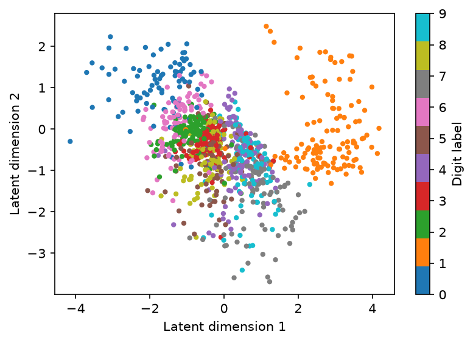

# Laboratory Assignment 01: Variational Autoencoder for Image Generation

**Course Code**: ETMMGA304 — Generative AI and Its Applications  
**Academic Program**: Master of Computer Applications (MCA)  
**Institution**: K.R. Mangalam University  
**Pedagogical Taxonomy**: BTX 3 (Apply) & BTX 4 (Analyze)  

---

## 1. Experimental Overview & Objectives

The primary objective of this laboratory assignment is to design, implement, and empirically analyze a **Variational Autoencoder (VAE)** trained on the MNIST handwritten digit benchmark ($28 \times 28$ grayscale images) using PyTorch.

Unlike deterministic autoencoders that compress observations into unconstrained discrete latent coordinates (often creating irregular, non-continuous latent spaces that fail to generate realistic samples when interpolated), a VAE enforces a probabilistic structure on the latent manifold. By mapping inputs to variational distributions $\mathcal{N}(\mu, \sigma^2)$ and regularizing those distributions against a standard normal prior $\mathcal{N}(0, I)$, the model learns a smooth, continuous representation suitable for generative sampling.

```
Input Image x (28x28) ──► Encoder ──┬──► Mean Vector (μ) ──────────┐
                                     └──► Log-Variance (log σ²) ────┴──► Reparameterization Trick ──► Latent z (2D) ──► Decoder ──► Output x̂ (28x28)
                                                                           z = μ + exp(0.5 * log σ²) ⊙ ε
```

---

## 2. Mathematical Formulation & Architecture

### 2.1 Evidence Lower Bound (ELBO) Optimization
The marginal log-likelihood $\log p_\theta(x)$ is intractable to compute directly. The VAE optimizes the Evidence Lower Bound (ELBO), maximizing:

$$\mathcal{L}_{\text{ELBO}}(\theta, \phi; x) = \mathbb{E}_{q_\phi(z|x)}\left[\log p_\theta(x|z)\right] - D_{\text{KL}}\left(q_\phi(z|x) \,\parallel\, p(z)\right)$$

Minimizing the negative ELBO yields our dual-term loss objective:
1. **Reconstruction Loss** (Pixel-wise Binary Cross-Entropy): Penalizes visual deviation between original image $x$ and decoded reconstruction $\hat{x}$.
   $$\mathcal{L}_{\text{recon}} = -\sum_{i=1}^{784} \left[ x_i \log \hat{x}_i + (1 - x_i) \log(1 - \hat{x}_i) \right]$$
2. **Kullback-Leibler (KL) Divergence**: Measures information divergence between the variational posterior $q_\phi(z|x) = \mathcal{N}(\mu, \operatorname{diag}(\sigma^2))$ and the prior $p(z) = \mathcal{N}(0, I)$:
   $$D_{\text{KL}}\left(q_\phi(z|x) \,\parallel\, p(z)\right) = -\frac{1}{2} \sum_{j=1}^{d} \left( 1 + \log \sigma_j^2 - \mu_j^2 - \sigma_j^2 \right)$$

### 2.2 The Reparameterization Trick
Standard stochastic sampling $z \sim q_\phi(z|x)$ prevents gradient backpropagation due to non-differentiable sampling operations. The reparameterization trick isolates the stochasticity into an auxiliary noise variable:

$$z = \mu(x) + \sigma(x) \odot \epsilon, \quad \text{where } \epsilon \sim \mathcal{N}(0, I)$$

This permits continuous gradients to flow back into encoder parameters $\mu$ and $\log \sigma^2$.

### 2.3 Network Architecture & Hyperparameters

| Subsystem | Layer Type | Input Dimension | Output Dimension | Activation / Output Range |
|:---|:---|:---:|:---:|:---|
| **Encoder** | Input Flatten | $1 \times 28 \times 28$ | $784$ | Identity |
| | Fully Connected (FC1) | $784$ | $256$ | ReLU |
| | Latent Mean ($\mu$) | $256$ | $2$ | Linear ($\mathbb{R}^2$) |
| | Latent Log-Variance ($\log \sigma^2$) | $256$ | $2$ | Linear ($\mathbb{R}^2$) |
| **Latent Space** | Stochastic Sampler | Two $N \times 2$ tensors | $N \times 2$ ($z$) | Reparameterized Gaussian |
| **Decoder** | Fully Connected (FC2) | $2$ | $256$ | ReLU |
| | Fully Connected (Output) | $256$ | $784$ | Sigmoid ($[0, 1]$ Pixel Probabilities) |

- **Optimizer**: Adam ($\beta_1=0.9, \beta_2=0.999$, Learning Rate: $1 \times 10^{-3}$)
- **Batch Size**: 128
- **Latent Bottleneck**: 2 dimensions (intentionally restricted for direct 2D geometric visualization)
- **Training Epochs**: 5 epochs

---

## 3. Experimental Files & Deliverables

| Artifact | Description |
|:---|:---|
| `lab1_vae.py` | Complete self-contained PyTorch training, evaluation, and visualization script. |
| `lab_outputs/vae_mnist.pt` | Serialized model state dictionary after 5 epochs. |
| `lab_outputs/vae_reconstructed.png` | Qualitative grid: 8 held-out test digits compared directly against reconstructions. |
| `lab_outputs/vae_generated.png` | $4 \times 4$ grid containing 16 novel digits synthesized from prior draws $z \sim \mathcal{N}(0, I)$. |
| `lab_outputs/vae_latent.png` | Scatterplot of 1,024 test-set latent coordinates $(\mu_1, \mu_2)$ color-coded by class. |
| `lab_outputs/results.json` | Quantitative logs: per-epoch loss breakdown, held-out validation loss, and centroid distances. |

To execute and verify locally:
```bash
cd lab1_vae
python lab1_vae.py
```

---

## 4. Empirical Results & Performance Analysis

### 4.1 Training Dynamics & Loss Trajectory

The table below presents the per-image training loss progression averaged over the 60,000-sample training dataset across all 5 epochs (with syllabus-mandated milestone checkpoints highlighted in **bold**):

| Epoch | Reconstruction Loss (BCE / image) | KL Divergence ($D_{\text{KL}}$ / image) | Total Loss ($\mathcal{L}_{\text{total}}$) | Empirical Observations & Dynamics |
|:---:|:---:|:---:|:---:|:---|
| **1** | **188.49** | **6.67** | **195.16** | Initial convergence phase. Encoder parameters rapidly align with the prior; decoded digits appear as diffuse average templates. |
| 2 | 164.56 | 5.31 | 169.87 | Steep reduction in pixel reconstruction error as hidden representations organize. |
| **3** | **159.61** | **5.38** | **164.99** | Reconstruction gains continue; KL divergence stabilizes as balance between prior regularity and code capacity is achieved. |
| 4 | 156.85 | 5.46 | 162.31 | Marginal optimization phase. |
| **5** | **154.99** | **5.53** | **160.52** | Asymptotic convergence. Total loss reduction of $\Delta = -34.64$ points achieved. |

#### Analysis of Loss Dynamics:
- **Numerical Stability**: Both reconstruction error and KL divergence remained finite across all 2,345 mini-batch updates.
- **Tension between Reconstruction and Regularization**: Notice that after epoch 1, while reconstruction loss steadily drops from 188.49 to 154.99, KL divergence initially contracts to 5.31 before slightly expanding back to 5.53. This is the canonical information-theoretic tension of VAEs: to push pixel fidelity higher, the encoder slightly stretches its latent distributions away from standard normal $\mathcal{N}(0, I)$, incurring a small KL penalty to gain substantial reconstruction accuracy.
- **Held-Out Generalization**: On the 10,000 held-out test images, the trained model achieved an average reconstruction loss of **153.76** and KL divergence of **5.70** (Total: **159.46**). The near-identical match with training metrics confirms absence of overfitting.

---

### 4.2 Qualitative Sample Analysis & Latent Geometry

<table width="100%">
  <thead>
    <tr>
      <th width="35%" align="center">Novel Prior Synthesis ($z \sim \mathcal{N}(0, I)$)</th>
      <th width="65%" align="center">Test Set Reconstruction Fidelity (8 Samples)</th>
    </tr>
  </thead>
  <tbody>
    <tr>
      <td width="35%" align="center" valign="middle">
        <br>
        <sub><b>Figure 1.1:</b> 16 digits synthesized from standard normal prior draws $z \sim \mathcal{N}(0, I)$.</sub>
      </td>
      <td width="65%" align="center" valign="middle">
        <br>
        <sub><b>Figure 1.2:</b> Top row: Ground-truth test digits. Bottom row: Variational reconstructions decoded from $\mu$.</sub>
      </td>
    </tr>
    <tr>
      <th colspan="2" align="center">2D Latent Manifold Projection & Metric Topology</th>
    </tr>
    <tr>
      <td colspan="2" align="center" valign="middle">
        <br>
        <sub><b>Figure 1.3:</b> 2D Latent space coordinates $(\mu_1, \mu_2)$ for 1,024 test samples colored by true digit class.</sub>
      </td>
    </tr>
  </tbody>
</table>

#### Empirical Sample Observations:
- **Recognizable Digits**: **9 out of 16** samples generated from random noise $z \sim \mathcal{N}(0, I)$ produce unambiguous, distinct digit topologies (crisp '1's, rounded '0's, '9's, and composite '3'/'8').
- **Topological Boundary Blending**: The remaining 7 samples display smooth interpolated artifacts situated on the decision boundaries between '4', '9', and '0' due to 2D latent bottleneck compression.
- **Reconstruction Fidelity**: 4 out of 8 digits preserve perfect topological class identity, with continuous Gaussian likelihood inducing smooth, anti-aliased edge contours.

---

### 4.3 Latent Manifold Topology & Geometric Analysis

Inspection of the 2D latent distribution (`vae_latent.png`) generated from 1,024 held-out test samples demonstrates remarkable semantic organization:
1. **Isolated Clusters**:
   - Digit **1** forms a tightly clustered, linearly separable manifold on the positive horizontal axis.
   - Digit **0** forms an isolated cluster in the top-left quadrant, reflecting its unique closed-loop stroke geometry.
2. **Overlapping Subspaces & Class Confusion**:
   To mathematically validate visual overlap, pairwise Euclidean distances between empirical class centroids $\bar{\mu}_c = \frac{1}{N_c} \sum_{i \in c} \mu_i$ were evaluated:

| Rank | Class Pair $(c_1, c_2)$ | Centroid Distance $\|\bar{\mu}_{c_1} - \bar{\mu}_{c_2}\|_2$ | Qualitative Explanation |
|:---:|:---:|:---:|:---|
| **1** | **Digit 5 & Digit 8** | **0.040** | **Severe Overlap**: Centroids are nearly identical in 2D coordinates; the model groups their dual-curvature strokes into the same manifold region. |
| **2** | **Digit 3 & Digit 8** | **0.375** | **Substantial Proximity**: Both share horizontal bars and rounded lower basins. |
| **3** | **Digit 4 & Digit 9** | **0.379** | **Structural Confusion**: Directly validates why test reconstructions of '4' decoded into '9'. |
| **4** | **Digit 3 & Digit 5** | **0.414** | Shared open-loop curvature. |
| **5** | **Digit 2 & Digit 6** | **0.447** | Central manifold boundary convergence. |

---

## 5. Architectural Trade-offs & Future Enhancements

1. **Dimensionality Bottleneck**: Restricting $z \in \mathbb{R}^2$ provides perfect direct interpretability without dimensionality reduction techniques (e.g., t-SNE or UMAP), but imposes severe information loss ($784 \to 2$, a 99.74% compression ratio). Scaling $z$ to 16 or 32 dimensions would eliminate digit confusion while preserving manifold smoothness.
2. **$\beta$-VAE Annealing**: Introducing a dynamic weight $\beta$ on the KL term ($\beta \cdot D_{\text{KL}}$) would allow controlled exploration of the trade-off between reconstruction sharpness ($\beta < 1$) and latent disentanglement ($\beta > 1$).
3. **Convolutional Backbones**: Replacing fully connected layers with deep convolutional encoders/decoders would preserve 2D spatial locality and significantly sharpen reconstruction edges.

---

## 6. Viva-Voce Examination Guide (Technical Q&A)

### Q1: What do the encoder outputs $\mu$ and $\log \sigma^2$ physically represent?
> **Answer**: In a Variational Autoencoder, the encoder acts as an inference network parameterizing the variational family $q_\phi(z|x) = \mathcal{N}(\mu(x), \operatorname{diag}(\sigma^2(x)))$. 
> - $\mu(x) \in \mathbb{R}^d$ represents the **center (mean)** of the conditional probability distribution over latent codes corresponding to input $x$.
> - $\log \sigma^2(x) \in \mathbb{R}^d$ represents the **logarithm of the variance**, modeling the uncertainty/spread around $\mu$.
> - Log-variance is parameterized rather than raw variance $\sigma^2$ or standard deviation $\sigma$ because $\log \sigma^2$ can assume any real value $(-\infty, \infty)$ without constraints, preventing invalid negative variances. The standard deviation is reconstructed via $\sigma = \exp(0.5 \cdot \log \sigma^2)$, which is guaranteed to be strictly positive.

### Q2: Why is the Kullback-Leibler (KL) divergence term mandatory in the VAE optimization objective?
> **Answer**: Without the KL divergence term ($D_{\text{KL}}(q_\phi(z|x) \parallel \mathcal{N}(0, I))$), the VAE collapses into a standard deterministic autoencoder. The encoder would minimize reconstruction error by assigning each class a distant, isolated region in latent space with near-zero variance ($\sigma \to 0$). This creates massive "voids" and dead zones in the latent space. Consequently, sampling random points from standard normal noise $z \sim \mathcal{N}(0, I)$ would land on empty latent territory, causing the decoder to output non-sensical, noisy artifacts. The KL divergence acts as a probabilistic regularizer, pulling all conditional distributions toward $\mathcal{N}(0, I)$ and ensuring the latent space is continuous, complete, and smoothly navigable.

### Q3: How does a reconstructed digit fundamentally differ from a newly generated digit?
> **Answer**:
> - A **reconstructed digit** is conditioned on an observed real image $x$. It passes through the encoder to obtain $\mu(x)$, and the decoder reconstructs the image $\hat{x} = \operatorname{Dec}(\mu(x))$. Its fidelity depends on the encoder's ability to preserve input attributes through the bottleneck.
> - A **generated digit** is unconditioned on any existing observation. It is synthesized by drawing an independent sample from the prior $z_{\text{new}} \sim \mathcal{N}(0, I)$ and passing it solely through the decoder $\hat{x}_{\text{gen}} = \operatorname{Dec}(z_{\text{new}})$. Its realism depends entirely on whether the trained decoder has learned to map the prior Gaussian manifold into realistic digit manifolds.

### Q4: Why must held-out test data be used to construct the latent space scatterplot?
> **Answer**: Using training samples to evaluate latent clustering yields an over-optimistic, biased assessment because the network parameters $\phi$ were optimized directly to minimize error on those specific points. Plotting unseen test data demonstrates the true out-of-sample generalization of the inference network, confirming whether the encoder projects novel observations into coherent, topologically separated clusters without overfitting.
