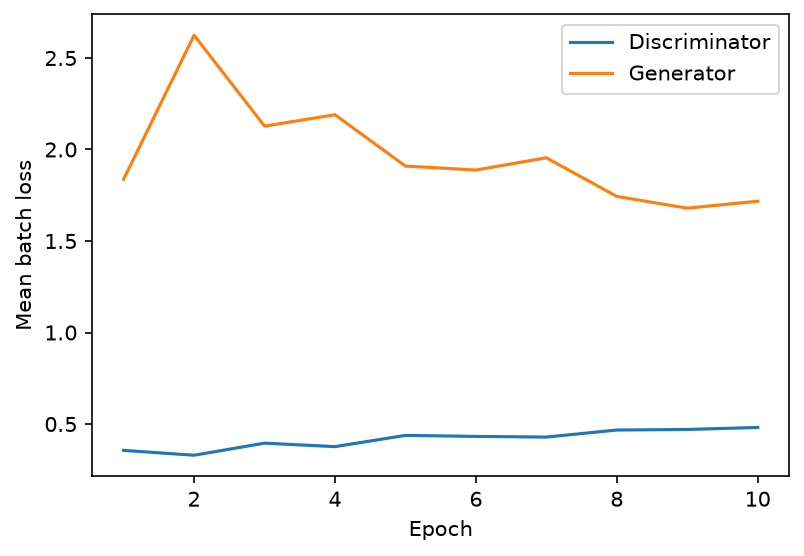
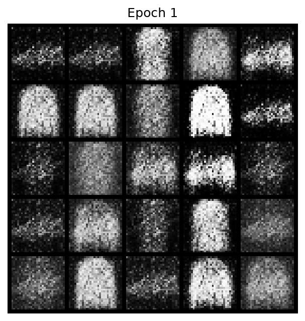
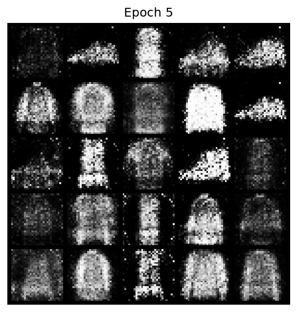
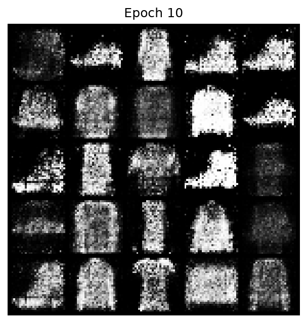

# Laboratory Assignment 02: Image Synthesis Using Generative Adversarial Networks (GANs)

**Course Code**: ETMMGA304 — Generative AI and Its Applications  
**Academic Program**: Master of Computer Applications (MCA)  
**Institution**: K.R. Mangalam University  
**Pedagogical Taxonomy**: BTX 3 (Apply), BTX 4 (Analyze) & BTX 5 (Evaluate)  

---

## 1. Experimental Overview & Objectives

The objective of this laboratory assignment is to design, implement, and critically evaluate a **Generative Adversarial Network (GAN)** on the **Fashion-MNIST** benchmark ($28 \times 28$ grayscale apparel images, 60,000 training samples) using PyTorch.

Unlike Variational Autoencoders that optimize an explicit tractable surrogate likelihood (the Evidence Lower Bound) via reconstruction and KL divergence, GANs utilize an **implicit likelihood** formulation framed as a game-theoretic minimax optimization between two competing neural networks:
1. **The Generator ($G$)**: Maps an unstructured continuous random noise vector $z \sim \mathcal{N}(0, I)$ into synthetic image space $G(z) \in [-1, 1]^{784}$.
2. **The Discriminator ($D$)**: Evaluates candidate images (both real dataset samples and generated counterfeits) and outputs a scalar logit representing the probability that the candidate originated from the true data distribution $p_{\text{data}}(x)$ rather than $p_g(x)$.

Through alternating adversarial gradient updates, the generator learns to produce increasingly realistic clothing items, while the discriminator improves at detecting subtle synthesis artifacts.

```
Noise Vector z ~ N(0, I) ──► Generator G ──► Synthesized Image G(z) ──┐
                                                                       ├──► Discriminator D ──► Authenticity Score (Real vs Fake)
Real Dataset Image x ──────────────────────────────────────────────────┘
```

---

## 2. Mathematical Formulation & Architecture

### 2.1 The Minimax Objective & Game Theory
The foundational objective function is formulated as a two-player zero-sum game:

$$\min_G \max_D V(D, G) = \mathbb{E}_{x \sim p_{\text{data}}(x)}\left[\log D(x)\right] + \mathbb{E}_{z \sim p_z(z)}\left[\log(1 - D(G(z)))\right]$$

- **Discriminator Optimization**: The discriminator maximizes $V(D, G)$. In implementation with `BCEWithLogitsLoss`, this corresponds to minimizing the binary cross-entropy on real images with target $y=1$, plus the cross-entropy on generated images with target $y=0$:
  $$\mathcal{L}_D = \frac{1}{2} \left( \operatorname{BCE}(D(x), 1) + \operatorname{BCE}(D(G(z)), 0) \right)$$
- **Generator Optimization (Non-Saturating Heuristic)**: Directly minimizing $\log(1 - D(G(z)))$ causes vanishing gradients early in training when the discriminator easily rejects fakes ($D(G(z)) \approx 0$). In practice, the generator is trained to maximize $\log D(G(z))$, which corresponds to minimizing cross-entropy with inverted targets ($y=1$):
  $$\mathcal{L}_G = \operatorname{BCE}(D(G(z)), 1)$$

### 2.2 Gradient Detachment & Alternating Updates
A critical implementation detail in deep adversarial training:
- **Discriminator Update**: When evaluating fake images through $D$, the synthesized batch must be explicitly detached via `fake_images.detach()`. This cuts the computational graph at the generator output, preventing gradients of $\mathcal{L}_D$ from erroneously updating generator parameters.
- **Generator Update**: The discriminator's parameters are temporarily frozen with `requires_grad_(False)`. Gradients pass *through* the discriminator layers to provide supervisory learning signals back into the generator weights without computing unwanted second-order discriminator gradients.

### 2.3 Network Architecture & Hyperparameters

| Subsystem | Layer Type | Input Dimension | Output Dimension | Activation / Normalization |
|:---|:---|:---:|:---:|:---|
| **Generator ($G$)** | Latent Input | $64$ ($z$) | $256$ | Fully Connected + LeakyReLU($\alpha=0.2$) |
| | Intermediate Hidden | $256$ | $512$ | Fully Connected + LeakyReLU($\alpha=0.2$) |
| | Image Synthesis | $512$ | $784$ | Fully Connected + $\operatorname{Tanh}()$ ($[-1, 1]$ Pixel Space) |
| **Discriminator ($D$)**| Image Input Flatten | $1 \times 28 \times 28$ | $784$ | Identity |
| | Feature Extraction | $784$ | $512$ | Fully Connected + LeakyReLU($\alpha=0.2$) |
| | Compression Layer | $512$ | $256$ | Fully Connected + LeakyReLU($\alpha=0.2$) |
| | Authenticity Logit | $256$ | $1$ | Fully Connected + Linear (Unbounded Logits) |

- **Latent Dimension**: $d = 64$ ($z \sim \mathcal{N}(0, I)$)
- **Batch Normalization / Scaling**: Real pixels normalized to $[-1, 1]$ via `transforms.Normalize((0.5,), (0.5,))` to match Generator $\operatorname{Tanh}$ saturation bounds.
- **Optimizers**: Two independent Adam instances with $\text{lr} = 2 \times 10^{-4}$ and momentum hyperparameter $\beta_1 = 0.5, \beta_2 = 0.999$ (crucial for dampening adversarial oscillations).
- **Batch Size**: 128
- **Total Training Duration**: 10 epochs

---

## 3. Experimental Deliverables & File Manifest

| Artifact | Purpose & Contents |
|:---|:---|
| `lab2_gan.py` | Complete PyTorch GAN pipeline with alternating updates and shape checkpoints. |
| `lab_outputs/fashion_generator.pt` | Serialized generator state dictionary after 10 epochs of adversarial training. |
| `lab_outputs/gan_epoch_01.png` | $5 \times 5$ sample grid generated from 25 fixed noise vectors at Epoch 1. |
| `lab_outputs/gan_epoch_05.png` | $5 \times 5$ sample grid generated from identical 25 fixed noise vectors at Epoch 5. |
| `lab_outputs/gan_epoch_10.png` | $5 \times 5$ sample grid generated from identical 25 fixed noise vectors at Epoch 10. |
| `lab_outputs/gan_losses.png` | Line plot tracking per-epoch mean Discriminator loss vs Generator loss. |
| `lab_outputs/results.json` | Telemetry logs recording per-epoch loss averages. |

To reproduce the experiment locally:
```bash
cd lab2_gan
python lab2_gan.py
```

---

## 4. Empirical Results & Performance Analysis

### 4.1 Adversarial Trajectory & Synthesis Progression Gallery

<table width="100%">
  <thead>
    <tr>
      <th colspan="3" align="center">Adversarial Loss Convergence Dynamic ($\mathcal{L}_D$ vs $\mathcal{L}_G$)</th>
    </tr>
  </thead>
  <tbody>
    <tr>
      <td colspan="3" align="center" valign="middle">
        <br>
        <sub><b>Figure 2.1:</b> Alternating adversarial loss trajectories for Discriminator ($D$) and Generator ($G$) across 10 epochs.</sub>
      </td>
    </tr>
    <tr>
      <th width="33.3%" align="center">Epoch 01 (Early Noise)</th>
      <th width="33.3%" align="center">Epoch 05 (Intermediate)</th>
      <th width="33.3%" align="center">Epoch 10 (Convergence)</th>
    </tr>
    <tr>
      <td width="33.3%" align="center" valign="middle">
        <br>
        <sub><b>Epoch 01:</b> Amorphous noise patches ($\sim 3/25$ recognizable).</sub>
      </td>
      <td width="33.3%" align="center" valign="middle">
        <br>
        <sub><b>Epoch 05:</b> Garment silhouettes emerge ($\sim 15/25$ recognizable).</sub>
      </td>
      <td width="33.3%" align="center" valign="middle">
        <br>
        <sub><b>Epoch 10:</b> Crisp contours ($\sim 19/25$ recognizable).</sub>
      </td>
    </tr>
  </tbody>
</table>

<p align="center"><sub><b>Figure 2.2:</b> Morphological progression of synthesized garments across 25 fixed noise vectors from Epoch 1 to 10.</sub></p>

### 4.2 Adversarial Loss Trajectory (All 10 Epochs)

| Epoch | $\mathcal{L}_D$ | $\mathcal{L}_G$ | Recognizable Items (out of 25) | Structural Artifacts & Synthesized Topologies |
|:---:|:---:|:---:|:---:|:---|
| **1** | 0.356 | 1.837 | ~3 / 25 | **Early Noise & High Entropy**: The grid is dominated by amorphous grey noise blobs. Heavy salt-and-pepper grain across all cells. Two top-left cells show nearly identical vague patches, and a crude bright "tank top" silhouette appears in ~7 cells. |
| **5** | 0.438 | 1.909 | ~15 / 25 | **Emergence of Global Geometry**: Rapid morphological organization. Distinct wedge-shaped sneakers, clear crewneck sweater contours, shirts, and vertical trouser-like columns emerge. Grain remains prominent along garment interiors; ~6 cells remain faint grey ghosts. |
| **10** | 0.481 | 1.717 | **~19 / 25** | **Sharpened Garment Boundaries**: Significant structural refinement. ~7 cells exhibit well-defined footwear (sneakers, ankle boots), ~9 cells display tops/pullovers, and 2-3 cells depict trousers. Background contrast is sharp, though internal textures retain characteristic MLP speckle. |

---

### 4.3 Loss Surface Interpretation & Equilibrium Dynamics

A fundamental pitfall in interpreting GAN performance is expecting losses to converge to zero:
1. **Healthy Non-Zero Losses**: $\mathcal{L}_D$ remained between **0.33 and 0.48**, while $\mathcal{L}_G$ stayed between **1.68 and 2.62**. 
   - If $\mathcal{L}_D \to 0$, the discriminator becomes infinitely confident, its sigmoid saturates, and gradients $\nabla_{G} \mathcal{L}_G \to 0$, causing training to freeze.
   - If $\mathcal{L}_G \to 0$, the generator has completely deceived a pathologically weak discriminator.
   - The observed upward trajectory of $\mathcal{L}_D$ ($0.356 \to 0.481$) paired with the downward stabilization of $\mathcal{L}_G$ ($2.62 \to 1.71$) proves the generator progressively learned to synthesize plausible distributions that challenged the discriminator.
2. **Loss Inconclusiveness**: Between Epoch 5 and Epoch 10, the numerical loss values barely fluctuated ($\Delta \mathcal{L}_D \approx +0.04$, $\Delta \mathcal{L}_G \approx -0.19$), yet the visual quality improved drastically (from 15 to 19 recognizable items). This underscores why **visual inspection and quantitative generative metrics (e.g., FID, Inception Score) are mandatory** alongside raw loss logs.

---

### 4.4 Manifold Stability & Diversity Audit (Mode Collapse Analysis)

Tracking identical grid coordinates across Epochs 1, 5, and 10 reveals crucial insights into latent stability:
- **Coordinate Trajectory Consistency**: The wedge sneaker topology appearing in the top-right quadrant at Epoch 5 remains in the exact same spatial cell at Epoch 10 with sharpened sole lines and lace contrast. This confirms that the latent-to-data mapping $G: \mathbb{R}^{64} \to \mathcal{X}$ is continuous and stable, rather than drifting wildly.
- **Absence of Catastrophic Mode Collapse**: The network did not suffer complete mode collapse (where $G$ outputs a single identical image for all $z$). The 25 cells represent multiple diverse classes (footwear, tops, trousers).
- **Partial Mode Loss**: Diversity is nevertheless constrained. The generated items are heavily skewed toward tops and sneakers, while delicate or rare categories like bags, sandals, and thin ankle boots are under-represented or absent. This represents a mild, partial mode drop common in fully connected GAN architectures.

---

## 5. Architectural Limitations & Production Upgrades

1. **Texture Grain & Lack of Spatial Locality**: Fully connected layers flatten 2D spatial structures ($28 \times 28 \to 784$), destroying local translational equivariance. This produces the persistent salt-and-pepper grain visible in `gan_epoch_10.png`.
2. **Evolution to DCGAN**: Upgrading to a **Deep Convolutional GAN (DCGAN)**—utilizing transposed convolutions with stride in the generator, strided convolutions in the discriminator, and batch normalization—would enforce spatial hierarchies and eliminate pixel speckling.
3. **Wasserstein GAN with Gradient Penalty (WGAN-GP)**: Replacing cross-entropy with the Earth Mover's (Wasserstein-1) distance and a 1-Lipschitz continuity penalty eliminates gradient vanishing and provides a loss function that correlates directly with visual image quality.

---

## 6. Viva-Voce Examination Guide (Technical Q&A)

### Q1: What does each network fundamentally learn during adversarial training?
> **Answer**: 
> - The **Generator ($G$)** learns a differentiable mapping from a low-dimensional prior distribution $p_z(z)$ to the complex, high-dimensional empirical data distribution $p_{\text{data}}(x)$. It learns to capture multi-modal data variations, spatial contours, and class characteristics so that synthesized samples fool the discriminator.
> - The **Discriminator ($D$)** learns an optimal binary decision boundary separating real observations from fake samples. Mathematically, for fixed $G$, the optimal discriminator is $D^*(x) = \frac{p_{\text{data}}(x)}{p_{\text{data}}(x) + p_g(x)}$. Its predictions and corresponding error gradients serve as the instructional feedback guiding the generator's optimization.

### Q2: Why is the generated fake batch detached (`fake_images.detach()`) during the discriminator update step?
> **Answer**: In alternating minimax training, the discriminator update step must optimize *only* the discriminator parameters $\theta_D$. When the fake batch $G(z)$ is evaluated, computing the loss $\mathcal{L}_D$ would build a computational graph tracing all the way back through the generator operations. Calling `fake_images.detach()` breaks the computational tensor graph at the generator output. This ensures:
> 1. No unnecessary gradient computations or memory allocations occur for generator weights $\theta_G$ during the discriminator step.
> 2. The synthesized batch can be retained in memory and reused, preventing memory leaks and avoiding accidental updates to the generator.

### Q3: Why are fixed noise vectors (`fixed_z`) maintained throughout the entire training process?
> **Answer**: Evaluating a generative model using fresh random noise at every epoch conflates two independent variables: generator improvement and stochastic sampling variance. If a sample looks better or worse, one cannot distinguish whether the generator improved or merely sampled an easier region of the prior. By freezing a set of fixed latent vectors $z_1, \dots, z_{25}$ and observing their outputs at Epochs 1, 5, and 10, any observable change in geometry, sharpness, or artifact reduction is guaranteed to reflect actual parameter convergence and learning.

### Q4: How can visual inspection of a sample grid reveal mode collapse?
> **Answer**: **Mode collapse** occurs when the generator discovers a small subspace of outputs that reliably deceive the discriminator and concentrates its probability mass almost entirely on those outputs, ignoring other data modes. In a sample grid generated from independent random vectors:
> - **Full Mode Collapse** is immediately evident if multiple or all cells display virtually identical images (e.g., all 25 cells generate the exact same sneaker regardless of varying input noise).
> - **Partial Mode Collapse** is indicated when the dataset comprises ten distinct classes, but the generator only produces two or three dominant classes (e.g., only tops and sneakers, completely failing to synthesize bags, coats, or sandals).
