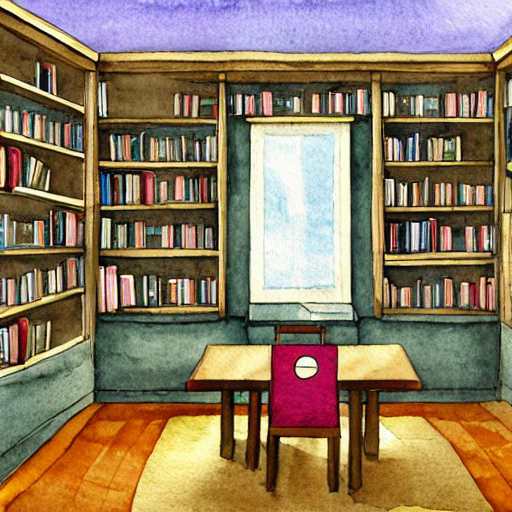

# Laboratory Assignment 04: Multimodal Prompt-to-Image Generation with Stable Diffusion

**Course Code**: ETMMGA304 — Generative AI and Its Applications  
**Academic Program**: Master of Computer Applications (MCA)  
**Institution**: K.R. Mangalam University  
**Pedagogical Taxonomy**: BTX 3 (Apply), BTX 4 (Analyze) & BTX 5 (Evaluate)  

---

## 1. Experimental Overview & Objectives

The primary objective of this laboratory assignment is to analyze the mechanics of **Multimodal Latent Diffusion Models (LDMs)** using **Stable Diffusion v1.5** (`stable-diffusion-v1-5/stable-diffusion-v1-5`). 

Standard pixel-space diffusion models operate directly on raw high-resolution RGB matrices, incurring prohibitive computational costs during training and inference. Stable Diffusion solves this by operating within a compressed latent manifold.

This experiment implements a **controlled factorial ablation**:
- **Subject Constant**: *"A small library with a reading table, wide view"*
- **Independent Variable 1 (Artistic Medium Modifier)**: *"watercolor illustration"* vs *"pencil sketch"*
- **Independent Variable 2 (Latent Noise Initialization)**: Generator Seed 42 vs Generator Seed 43
- **Invariance Protocol**: By holding latent seeds and generation hyperparameters ($512 \times 512$, 25 steps, $\text{CFG}=7.5$) identical across prompt variations, we systematically disentangle the structural influence of the random noise prior from the semantic guidance of text tokens.

```
Text Prompt y ──► Frozen CLIP Text Encoder ──► Conditioning Vector c
                                                      │ (Cross-Attention)
                                                      ▼
Noise Vector z_T ~ N(0, I) ──────────────► Denoising Latent UNet (25 steps) ──► Denoised Latent z_0 ──► VAE Decoder ──► Output Image x (512x512)
(Seed 42 / 43)                              [Classifier-Free Guidance s=7.5]
```

---

## 2. Theoretical Foundations & Mathematical Formulations

### 2.1 Latent Space Denoising (LDM Architecture)
Rather than computing diffusion steps in pixel space $\mathbb{R}^{3 \times 512 \times 512}$, Stable Diffusion employs a pre-trained Autoencoder:
1. **VAE Encoder ($\mathcal{E}$)**: Compresses image $x$ into latent code $z = \mathcal{E}(x) \in \mathbb{R}^{4 \times 64 \times 64}$, yielding an $8\times$ spatial downsampling factor ($64\times$ reduction in computational operations).
2. **Forward Diffusion (Noising)**: Adds Gaussian noise according to variance schedule $\beta_1, \dots, \beta_T$:
   $$q(z_t \mid z_0) = \mathcal{N}\left(z_t; \sqrt{\bar{\alpha}_t} z_0, (1 - \bar{\alpha}_t) I\right)$$
3. **Reverse Diffusion (Denoising UNet)**: A time-conditioned UNet $\epsilon_\theta(z_t, t, c)$ trained to predict the noise added at timestep $t$ given latent $z_t$ and conditioning text embeddings $c = \tau_\theta(y)$.
4. **VAE Decoder ($\mathcal{D}$)**: Decodes the final cleaned latent vector back into RGB space: $\hat{x} = \mathcal{D}(z_0)$.

### 2.2 Classifier-Free Guidance (CFG)
To steer generation toward the conditioning text prompt without needing a separate classifier, the model performs two forward passes at each denoising step—one conditioned on text prompt $c$, and one unconditioned (using an empty string prompt $\emptyset$):

$$\hat{\epsilon}_\theta(z_t, c) = \epsilon_\theta(z_t, \emptyset) + s \cdot \left( \epsilon_\theta(z_t, c) - \epsilon_\theta(z_t, \emptyset) \right)$$

- When guidance scale $s = 1.0$, standard unconditional + conditional scoring is applied.
- When $s = 7.5$ (as utilized here), the trajectory moves significantly in the direction pointing away from the unconditional prior toward prompt alignment, substantially sharpening adherence to prompt keywords.

### 2.3 Hardware Optimization: Attention Slicing & FP16
Executing Stable Diffusion on consumer GPUs (e.g., NVIDIA RTX 3050 Laptop GPU with 6.0 GB VRAM) requires memory optimizations:
- **FP16 Half-Precision**: Cuts model memory footprint from ~8 GB to ~4.2 GB.
- **Attention Slicing**: Splits cross-attention tensor operations into sequential slices rather than computing large $[B, \text{Heads}, N, N]$ matrices simultaneously, preventing GPU Out-Of-Memory (OOM) exceptions.

---

## 3. Experimental Deliverables & File Manifest

| Artifact | Description |
|:---|:---|
| `lab4_stable_diffusion.py` | PyTorch/Diffusers inference script with attention slicing, safety filtering, and latency logging. |
| `lab_outputs/library_prompt_1_seed_42.png` | Synthesis for Prompt 1 (Watercolor) at Seed 42. |
| `lab_outputs/library_prompt_1_seed_43.png` | Synthesis for Prompt 1 (Watercolor) at Seed 43. |
| `lab_outputs/library_prompt_2_seed_42.png` | Synthesis for Prompt 2 (Pencil sketch) at Seed 42. |
| `lab_outputs/library_prompt_2_seed_43.png` | Synthesis for Prompt 2 (Pencil sketch) at Seed 43. |
| `lab_outputs/results.json` | Execution telemetry: GPU identifier, generation parameters, latency, and safety checker status. |

To reproduce locally:
```bash
cd lab4_stable_diffusion
python lab4_stable_diffusion.py
```

---

## 4. Empirical Evaluation & Observation Table

Evaluation uses the syllabus standard scale ($0$: Missing, $1$: Partial, $2$: Strong).  
**Subject Score** evaluates structural presence (*small library, reading table, wide view*).  
**Style Score** evaluates artistic medium adherence (*watercolor wash vs graphite pencil linework*).

<div align="center">
  <table width="100%">
    <thead>
      <tr>
        <th width="50%" align="center">Seed 42</th>
        <th width="50%" align="center">Seed 43</th>
      </tr>
    </thead>
    <tbody>
      <tr>
        <td align="center">
          <br>
          <b>Prompt 1: Watercolor Illustration</b> (Score: 1/2 Subj, 2/2 Style)
        </td>
        <td align="center">
          <br>
          <b>Prompt 1: Watercolor Illustration</b> (Score: 2/2 Subj, 2/2 Style)
        </td>
      </tr>
      <tr>
        <td align="center">
          <br>
          <b>Prompt 2: Pencil Sketch</b> (Score: 1/2 Subj, 1/2 Style)
        </td>
        <td align="center">
          <br>
          <b>Prompt 2: Pencil Sketch</b> (Score: 2/2 Subj, 0/2 Style - Style Ignored)
        </td>
      </tr>
    </tbody>
  </table>
  <sub><b>Figure 4.1:</b> Paired 512x512 generations holding random noise seeds constant across medium variations.</sub>
</div>
<br>

| Prompt Variant | Seed | Subject Score (0-2) | Style Score (0-2) | Visual Composition, Perspective & Artifact Critique |
|:---|:---:|:---:|:---:|:---|
| **1. Watercolor** | **42** | **1** | **2** | **High Stylistic Adherence, Compositional Hallucination**: Excellent translucent watercolor washes with dark ink contour lines. A figure with long hair sits in the foreground facing an arched window. While a small desk is visible, an expansive "reading table" is absent, and the person was unprompted. An ambiguous large blue oval (pond/rug) occupies the foreground base. |
| **1. Watercolor** | **43** | **2** | **2** | **Optimal Generation of Suite**: Near-flawless adherence. Built-in wooden bookshelves flank three walls with atmospheric depth, featuring a central rectangular table and single wooden chair beneath natural window lighting. Delicate brushwork and pigment bleeding. Minor artifact: circular hollow cutout on chair backrest. |
| **2. Pencil Sketch**| **42** | **1** | **1** | **Partial Style Drift**: Monochromatic grey aesthetic featuring tall floor-to-ceiling shelves and an armchair, but lacks a reading table. The rendering resembles a digital vector ink line drawing rather than authentic graphite pencil with cross-hatch shading. Window pane geometry is uneven; foreground armchair is abruptly clipped. |
| **2. Pencil Sketch**| **43** | **2** | **0** | **Catastrophic Style Failure**: Subject geometry is well-rendered (bookshelves, corner table, wooden chair, bright window), but the style prompt was **completely ignored**. Synthesizes a photorealistic, full-color digital 3D render with warm timber lighting and saturated hues. Completely non-compliant with "pencil sketch". |

---

## 5. Disentanglement Analysis: Seed vs Prompt Guidance

A key insight emerges from comparing the paired outputs across seeds and styles:

```
                  ┌─────────────────────── Seed 42 ───────────────────────┐
                  │ Architecture: Two tall flanking bookcases + window    │
                  │ Foreground: Seated figure / Armchair perspective      │
                  └───────────────────────────┬───────────────────────────┘
                                              │
                      ┌───────────────────────┴───────────────────────┐
                      ▼                                               ▼
              [ Watercolor ]                                  [ Pencil Sketch ]
      Soft washes, blue palette                       Monochrome grey ink lines

                  ┌─────────────────────── Seed 43 ───────────────────────┐
                  │ Architecture: Corner room layout with lateral shelves  │
                  │ Centerpiece: Rectangular table + solitary chair       │
                  └───────────────────────────┬───────────────────────────┘
                                              │
                      ┌───────────────────────┴───────────────────────┐
                      ▼                                               ▼
              [ Watercolor ]                                  [ Pencil Sketch ]
        Vibrant pigment bleed                     Photorealistic color 3D render (Style Dropped)
```

1. **Spatial Layout Governed by Starting Noise**:
   - Both **Seed 42** images produce an identical axial spatial composition: two tall bookcases flanking a central window, with an object or figure situated in the immediate center-foreground.
   - Both **Seed 43** images produce an identical architectural perspective: an angled corner library room with shelves extending down the left wall and a solitary wooden table in the center.
   - *Conclusion*: The initial Gaussian noise tensor $z_T \sim \mathcal{N}(0, I)$ acts as a structural blueprint, determining perspective, vanishing points, and coarse bounding regions.
2. **Text Tokens Steer Textures and Pigments**:
   - The prompt text directs the diffusion process to fill those structural bounding boxes with either translucent watercolor pigments or monochrome strokes.
3. **Prompt Dropout Vulnerability**:
   - At Seed 43, the combination of starting noise and subject tokens ("small library", "reading table") exhibited a strong attractor basin toward warm interior photography, completely overpowering the cross-attention weight of the token "pencil sketch". This demonstrates why prompt evaluation must always span multiple seeds.

---

## 6. Real-World Applications, Ethics & Provenance

1. **Commercial / Pedagogical Utility**:
   - Rapid concept generation for storyboards, educational visual aids, and creative exploration. A designer can fix a preferred spatial seed and iterate on textual descriptors to test color palettes and lighting without destabilizing camera geometry.
2. **Algorithmic Stereotyping & Bias**:
   - In Prompt 1 (Seed 42), the model autonomously inserted a long-haired human figure reading at a desk despite zero mention of human beings in the prompt. This illustrates the demographic biases embedded in the LAION training dataset, which frequently co-associates libraries with specific gendered reader imagery.
3. **Intellectual Property & Training Provenance**:
   - Stable Diffusion was trained on uncurated web-scraped image-text pairs (LAION-5B), raising ongoing legal and ethical disputes regarding artist attribution, copyright infringement, and unauthorized style reproduction.
4. **Synthetic Media Disclosure & Watermarking**:
   - Photorealistic synthetic images (such as Prompt 2, Seed 43) can easily deceive viewers if presented out of context. Generative pipelines must incorporate machine-readable metadata standards (e.g., **C2PA cryptographic provenance**) and invisible frequency-domain watermarks (e.g., SynthID) to flag synthetic media.

---

## 7. Viva-Voce Examination Guide (Technical Q&A)

### Q1: Why must prompt variants be compared at the exact same random seed?
> **Answer**: In diffusion models, the random seed determines the initial Gaussian noise tensor $z_T \sim \mathcal{N}(0, I)$. This starting noise dictates the primary spatial composition, geometric contours, perspective, and lighting gradients of the scene. If prompt variants are evaluated using different random seeds, it is impossible to determine whether visual variations stem from the modified prompt wording or simply from different starting noise trajectories. Fixing the seed isolates the prompt modifier as the sole independent variable, enabling rigorous scientific ablation.

### Q2: What is the physical role of denoising steps in diffusion models?
> **Answer**: Diffusion models do not generate images in a single forward pass; they reverse a continuous degradation process. The forward process incrementally adds Gaussian noise until the image becomes pure noise. During inference, the denoising UNet predicts the noise component $\epsilon_\theta(z_t, t, c)$ present at timestep $t$. Over $N$ discrete steps (e.g., 25 steps using schedulers like DPMSolver or DDIM), this estimated noise is progressively subtracted while injecting text guidance. Early steps establish coarse structural layout and global geometry; intermediate steps construct object boundaries; final steps resolve high-frequency textures, surface details, and fine lighting.

### Q3: How can subject adherence and style adherence be rated independently?
> **Answer**: Subject and style evaluate orthogonal feature spaces:
> - **Subject Adherence** evaluates semantic object completeness: Are the requested nouns, entities, spatial relationships, and counts present (e.g., *Is there a small library? Is there a reading table? Is the view wide?*)?
> - **Style Adherence** evaluates artistic execution: Does the visual medium match the requested artistic technique, brushwork, texture, and palette (e.g., *Does it look like a translucent watercolor illustration or graphite pencil cross-hatching?*)?
> Separating these dimensions is crucial because a model may successfully generate the requested objects while failing the requested artistic style (as occurred in Prompt 2, Seed 43, which scored 2/2 for Subject but 0/2 for Style).

### Q4: When is programmatic disclosure mandatory for a generated image?
> **Answer**: Synthetic media disclosures are legally and ethically mandatory whenever:
> 1. An image could reasonably be mistaken for authentic photographic evidence of real people, places, or historical events (to prevent deepfakes, fraud, and political disinformation).
> 2. The image is deployed in journalism, academic publishing, legal proceedings, or commercial advertising.
> 3. Disclosures are mandated by emerging compliance frameworks (e.g., EU AI Act, US Executive Order on AI, and C2PA content authenticity standards).
